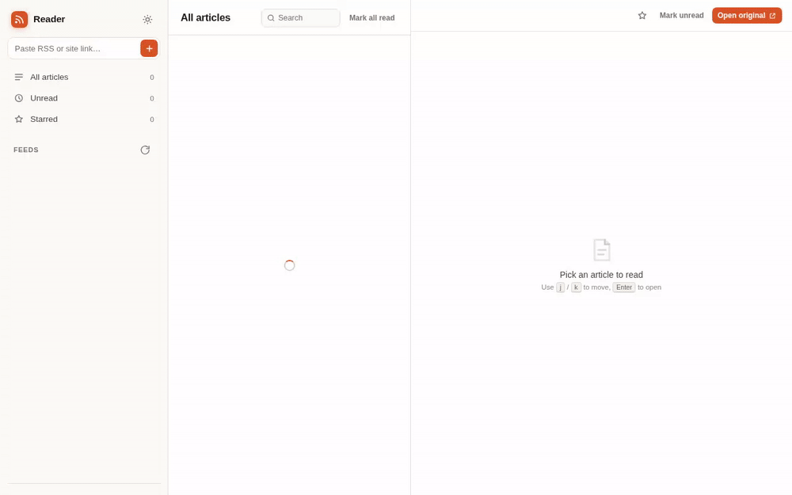

# Reader

**A small, dependency-free RSS reader.** Paste a link, get a clean place to read.

[](https://nodejs.org)
[](package.json)
[](https://www.deepseek.com)

> [!WARNING]
> **This project is vibecoded with DeepSeek.**



---

## What it is

Reader is a local web app that turns RSS, Atom and JSON feeds into a three-pane
reading experience: your feeds on the left, headlines in the middle, the article
on the right. It runs on Node.js with **no npm dependencies and no build step** —
the whole thing is about 3,000 lines of plain JavaScript, HTML and CSS.

- No accounts, no cloud, no analytics. Everything stays in a JSON file on your machine.
- No CORS problems: the server fetches feeds, not your browser.
- No full-text extraction or scraping: it shows what the feed publishes, plus a link
  to the original.

## Features

- **Paste anything**: RSS 2.0, RSS 1.0/RDF, Atom, JSON Feed, or a normal website URL
  (it finds the feed with `<link rel="alternate">` autodiscovery).
- **Three-pane reader** with responsive layout down to phone width.
- **Light and dark** themes, following your system by default.
- **Unread and starred** articles, per-feed unread badges, mark-all-read.
- **Search** the current view by title, summary or source.
- **Readable articles**: full feed content rendered with book-like typography inside
  a sandboxed iframe. “Open original” is always one click away.
- **Polite fetching**: caches feeds, sends `ETag` / `If-Modified-Since`, and refreshes
  stale feeds in the background every 10 minutes.
- **Keyboard-first** navigation (see the shortcut table below).
- **Zero dependencies**: just `node server.js`.

## Quick start

Requires **Node.js 20 or newer**. There is nothing to install.

```bash
cd rss_feed
npm start
```

Open **http://127.0.0.1:4173** and paste a feed link into the box at the top of the
sidebar. That's it.

```bash
npm stop        # stop the background server
npm run dev     # restart automatically while editing (Ctrl+C to quit)
```

`npm start` writes a PID file so `npm stop` can shut it down cleanly. If you start
the server in a terminal instead, `Ctrl+C` works as usual.

## Using Reader

### Add a feed

Paste a feed URL, or just a site URL — Reader will look for the feed link on the
page. Press **Enter** or the **+** button.

- Direct feed: `https://hnrss.org/frontpage`
- Site with autodiscovery: `https://www.theverge.com/`

If the site has no discoverable feed, Reader says so; find the RSS/Atom URL and
paste that instead.

### Read

Click a headline to open it in the reading pane. Opening an article marks it read.
**Open original** opens the source page in a new tab.

### Keep track

- **Unread** shows just what you haven't read; the orange dot marks unread articles.
- **Starred** is your saved list. Star from the list or the reading pane.
- **Mark all read** clears the current view (feed + filter).
- **Search** filters the current view as you type.

### Remove a feed

Hover a feed, click the trash icon, then **Remove**. The row switches to an inline
confirmation (`Remove feed?  [Remove] [Cancel]`) — nothing is deleted until you
confirm, and `Esc` cancels.

### Refresh

- **↻** next to “Feeds” refreshes everything.
- Stale feeds refresh automatically every 10 minutes (and when the tab becomes
  visible again).
- Failed feeds show a red **!** on their avatar; hover for the error. One bad feed
  never blocks the others.

## Keyboard shortcuts

| Key | Action |
| --- | --- |
| `j` / `↓` | Next article |
| `k` / `↑` | Previous article |
| `m` | Toggle read / unread |
| `s` | Toggle star |
| `o` | Open original in a new tab |
| `r` | Refresh all feeds |
| `/` | Focus search |
| `Esc` | Close article / cancel confirmation / clear search |

Shortcuts are ignored while you're typing in a field.

## Configuration

| Variable | Default | Purpose |
| --- | --- | --- |
| `PORT` | `4173` | HTTP port |
| `HOST` | `127.0.0.1` | Interface to bind. Use `0.0.0.0` to reach it from other devices |
| `DATA_DIR` | `./data` | Where the library is stored |

```bash
PORT=8080 HOST=0.0.0.0 npm start
PORT=8080 npm stop
```

Multiple libraries are just multiple data directories:

```bash
DATA_DIR=~/reading/work PORT=4174 node server.js
```

## Your data

Everything lives in **`data/store.json`**:

- the feeds you added,
- a cache of their latest items,
- which articles you've read or starred.

That file is written atomically (temp file + rename), so a crash won't corrupt it.
It never leaves your machine; the only outbound traffic is fetching the feeds
themselves.

To start over: `npm stop` and delete `data/store.json`. To back up, copy it.

## How it works

```
        HTTP + JSON API              fetch()
browser ───────────────▶ server.js ───────────▶ RSS / Atom / JSON feeds
   ▲                        │
   └────────────────────────┴──────────▶ data/store.json
```

| Path | What it does |
| --- | --- |
| `server.js` | HTTP server, JSON API, static files, feed fetching/caching, storage |
| `lib/feed.js` | Normalizes RSS/RDF/Atom/JSON, discovers feeds, sanitizes article HTML |
| `lib/xml.js` | A small XML parser (namespaces, CDATA, entities) |
| `public/index.html` | Page structure |
| `public/style.css` | Themes and responsive layout |
| `public/app.js` | UI rendering, state, keyboard handling, API calls |
| `scripts/stop.js` | PID-file based `npm stop` |
| `data/store.json` | Your library (created on first run) |

The server fetches a feed, parses it into one item shape regardless of format,
stores the latest items, and serves them as JSON. The frontend is plain DOM code
with no framework. Article HTML is stripped of scripts, iframes and event handlers,
then rendered inside an iframe with `sandbox` (no `allow-scripts`), so feed content
can't run code in the app.

## API

Useful if you want to script the reader or build another client.

| Method | Path | Purpose |
| --- | --- | --- |
| `GET` | `/api/feeds` | Feeds, unread counts, totals |
| `POST` | `/api/feeds` | Add a feed: `{ "url": "https://…" }` |
| `DELETE` | `/api/feeds/:id` | Remove a feed and its cached items |
| `POST` | `/api/feeds/:id/refresh` | Refresh one feed |
| `POST` | `/api/refresh` | Refresh all feeds |
| `GET` | `/api/items?filter=all\|unread\|starred&feed=:id&q=` | List articles |
| `GET` | `/api/items/:id` | One article, including `content` |
| `POST` | `/api/items/:id/read` | `{ "read": true }` |
| `POST` | `/api/items/:id/star` | `{ "starred": true }` |
| `POST` | `/api/read-all` | `{ "feed": "all", "filter": "unread" }` |

```bash
curl -X POST localhost:4173/api/feeds \
  -H 'content-type: application/json' \
  -d '{"url":"https://hnrss.org/frontpage"}'
```

## Troubleshooting

| Problem | What to do |
| --- | --- |
| “That page does not link to an RSS or Atom feed” | The site hides its feed. Find the exact RSS/Atom URL and paste that. |
| “Server returned HTTP 403/419/…” | The site blocks non-browser clients. Try a different feed URL or a mirror (e.g. `hnrss.org` instead of Hacker News' own `/rss`). |
| “Could not reach the server (ENOTFOUND/ECONNREFUSED)” | Outbound network, DNS, proxy or firewall issue on the machine running Reader. |
| Feed loads but an article is empty | The feed only publishes a short summary. Use **Open original**. |
| Port already in use | `PORT=8080 npm start` (and `PORT=8080 npm stop`). |
| UI looks stale after an update | Hard-refresh the tab (Ctrl/Cmd+Shift+R). |
| A feed shows a red `!` | Hover it to see the error; the other feeds keep working. Fix the URL by removing and re-adding it. |
| Wrong feeds after experimenting | `npm stop`, delete `data/store.json`, `npm start`. |

## Security and limitations

- **Local app, no authentication.** Don't expose it to the internet as-is. If you
  need remote access, put it behind a reverse proxy with auth (and HTTPS).
- The server will fetch whatever URL you give it, including internal addresses.
  Only run it for people you trust.
- Article content is sanitized and sandboxed, but it is still third-party HTML.
  External images load from their original sites.
- Single user, no sync, no full-text extraction, no offline images, no push.
- No automated tests — verify changes against a couple of real feeds.

## About

Reader was built in one sitting by **DeepSeek** (an AI model) from a short prompt
asking for an RSS reader with a paste-a-link flow. The code is intentionally plain
and readable so a human can audit or extend it. If you find rough edges, that's why.

If you build on it: the server is framework-free `node:http`, the frontend is
vanilla DOM, and both are small enough to read in an afternoon.

## License

Apache License 2.0 — see [LICENSE](LICENSE).
